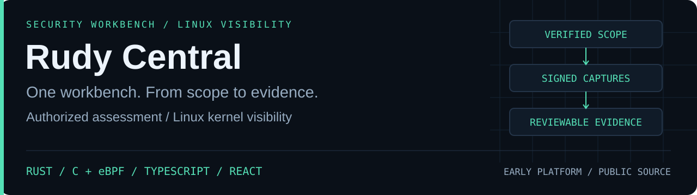

<strong>Define the scope. Follow the signals. Keep the evidence.</strong>

<a href="https://github.com/r4venrudy#selected-work">Selected work</a> · <a href="https://rudy.systems">Rudy Systems</a>

---

## One workbench, from scope to evidence

**Rudy Central is my security workbench.** It connects authorized assessment, Linux kernel visibility, evidence review, and remediation in a local-first browser workspace. The project brings native systems programming and a complete investigation interface together around one question: can an analyst follow an observation back to its evidence?

**Current stage: v0.2.0 / early platform. Source: public.** Explore the [implementation and operator documentation](https://github.com/r4venrudy/rudy-central) in the project repository.

## What it brings together

| Area            | Working capability                                                                        |
| :-------------- | :---------------------------------------------------------------------------------------- |
| Authorization   | Ownership challenges and scoped permits before native web checks                          |
| Assessment      | A bounded HTTPS security baseline with traceable observations                             |
| Linux telemetry | A Rust host agent and fixed C / eBPF programs for process and connection-attempt metadata |
| Evidence        | Signed captures, artifact hashes, offline tool-export imports, and replay checks          |
| Investigation   | Engagements, event inspection, finding ownership, notes, and remediation status           |
| Reporting       | Downloadable HTML and JSON, control records, and an audit trail                           |

## Built across four layers

| Layer                           | Technology                    |
| :------------------------------ | :---------------------------- |
| Kernel observation              | Restricted C / Linux eBPF     |
| Native host agent               | Rust / libbpf                 |
| Local control plane             | TypeScript / Node.js / SQLite |
| Browser investigation workspace | React / TypeScript            |

The native agent collects a bounded capture on an authorized Linux host. The workbench checks its signatures and scope before accepting the evidence. Analysts can then inspect events, combine imported findings, record remediation, and produce a report.

## Engineering focus

- **Explicit boundaries:** scoped collection, fixed kernel hooks, bounded resources, and privilege reduction after attachment.
- **Evidence that stays connected:** signed captures, artifact digests, checked imports, and a reviewable audit trail.
- **A complete workflow:** authorization, collection, investigation, remediation, and reporting in the same workspace.
- **Visible validation:** UI/API checks on Windows and Linux, native Rust checks, and real kernel capture with an API round trip on a Linux CI runner.

The kernel prototype has been exercised on one Linux kernel environment. Broader compatibility and sustained production performance remain unqualified. The tool registry is a catalog of capabilities and integrations; entries do not imply bundled or executable vendor products. Host signatures identify an enrolled key and do not establish hardware attestation or whether a host is uncompromised.

---

<strong>RUDY SYSTEMS</strong> <a href="https://rudy.systems">rudy.systems</a> · <a href="https://github.com/r4venrudy">More work by Raven</a>

